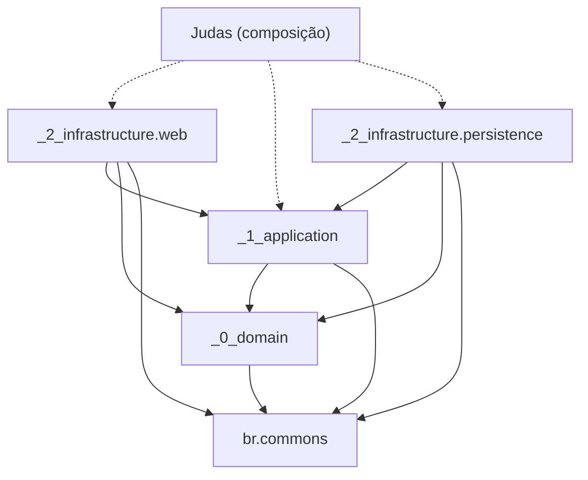
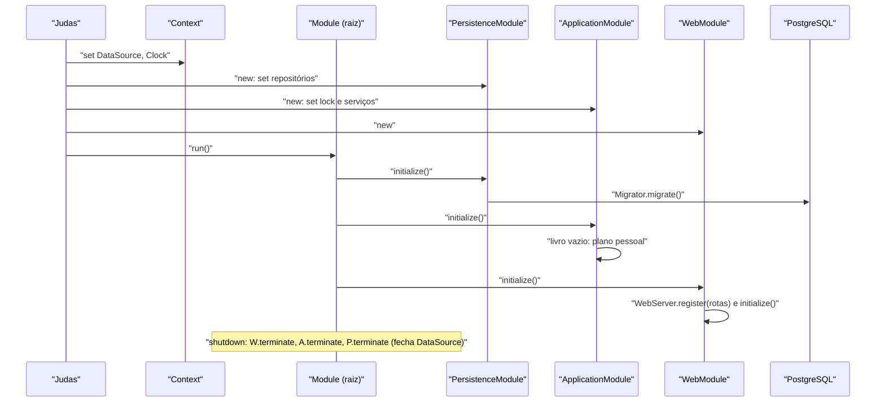

# Architecture

Este documento descreve os condutores arquiteturais a serem respeitados. Funcionalidades em [FEATURE.md](FEATURE.md);
estilo de código em [STYLE.md](STYLE.md); estilo visual em [UI.md](UI.md).

## 1. Camadas

```
br.bundled.judas
├── Judas                     ponto de entrada; registra infraestrutura (DataSource, Clock) no Context e anexa os módulos
├── _0_domain
│   ├── model                 Modelo de domínio
│   ├── service               Serviços Auxiliares
│   ├── repository            Repositório de objetos de domínio
├── _1_application            
│   ├── model                 Modelo de aplicação
│   ├── service               Serviços Auxiliares
│   ├── repository            Repositório de objetos de aplicação
├── _2_infrastructure
│   ├── persistence           Adaptadores para persistência de dados
│   └── web                   HTMX server-side; borda HTTP
```

## ARCH-01 

- Zero frameworks de mercado: tudo sai de `br.commons`.
- framework aceitos são `lombok`, `jspecify`, e frameworks de testes
- Domínio expõe contratos (`repository`, `service`) como interfaces;
  implementação fica na camada de fora (persistence/application).

## ARCH-02 Regra de dependência

O prefixo numérico é a ordem: uma camada importa só as de número menor, `br.commons` e o JDK.

| Camada | Pode depender de | Nunca de |
|---|---|---|
| `_0_domain` | `br.commons` (`business`, `lang`, `locale`, `money`), JDK | `_1_application`, `_2_infrastructure` |
| `_1_application` | `_0_domain`, `br.commons` | `_2_infrastructure` |
| `_2_infrastructure.persistence` | `_0_domain`, `_1_application` (contratos de repositório e modelo), `br.commons.persistence.jdbc` | `_2_infrastructure.web` |
| `_2_infrastructure.web` | `_1_application`, `_0_domain` (só leitura de tipos), `br.commons.web`, `br.commons.lang.html/htmx` | `_2_infrastructure.persistence` |
| `Judas` | todas | — |

- Os dois adaptadores de `_2_infrastructure` não se conhecem: só `Judas` vê os dois.
- A ligação em tempo de execução não é import: cada módulo registra implementações no `Context` pelo contrato
  (`Context.set(Interface.class, Impl::new)`) e quem precisa pede `Context.get(Interface.class)`.
- `new` de implementação de outra camada é proibido fora dos módulos (ARCH-04).
- A regra deve ser verificada por teste de arquitetura em `src/test/java/br/bundled/judas` (imports por pacote).



## ARCH-03 Composição (`Judas`)

`Judas extends br.Application`. `attach` é `protected final`: a árvore de módulos é montada **só no construtor** de
`Judas`, nesta ordem:

1. Infraestrutura no `Context`: `JDBCProperties` lidas das chaves `br.commons.judas.datasource.*`, `DataSource` e
   `Clock` (`America/Sao_Paulo`).
2. `attach(new PersistenceModule())`, `attach(new ApplicationModule())`, `attach(new WebModule())`.

```java
public Judas() {
    Context.set(DataSource.class, () -> new DataSource(JudasProperties.dataSource()));
    Context.set(Clock.class, () -> Clock.system(ZoneId.of("America/Sao_Paulo")));

    attach(new PersistenceModule());
    attach(new ApplicationModule());
    attach(new WebModule());
}
```

- Módulos nunca entram no `Context` (nem `Context.set(XModule.class)`): são ligação, não dependência. No `Context` só
  ficam infraestrutura, repositórios, serviços e objetos compartilhados (ex.: o lock do livro).
- A ordem de `attach` é contrato: define a ordem de construção, de `initialize` e (inversa) de `terminate`.

## ARCH-04 Ciclo de vida (`br.commons.module`)

Um módulo é um `Lifecycle` (`initialize()`/`terminate()` → `Result<Void, BusinessError>`). `Application#attach(Lifecycle)`
o envolve em `Module.of(lifecycle)` e o pendura na raiz. `Module` é uma árvore:

- `initialize`: as dependências (`attach`) na ordem anexada e só depois o próprio `Lifecycle`; a **primeira falha
  para tudo** (os seguintes não sobem).
- `terminate`: primeiro o próprio `Lifecycle` (só se o `initialize` dele deu certo), depois as dependências que
  chegaram a inicializar, em ordem inversa; uma falha não interrompe, volta a primeira.
- Uma dependência cuja `initialize` falhou entra na lista do que inicializou: as dependências **dela** são terminadas,
  mas o `terminate` do próprio `Lifecycle` falho **não** é chamado. Logo, um `initialize` que falha no meio desfaz
  sozinho o que já tinha aberto antes de devolver a falha.
- `Application#run` inicializa a árvore, mostra a falha (`BusinessError.toConsole`) e registra o shutdown hook que a
  termina. A JVM só segue viva com thread não-daemon (o `WebServer`).

Cada módulo tem **dois momentos**, e o que vai em cada um é regra:

| Momento | Onde | O que faz | O que nunca faz |
|---|---|---|---|
| Construção | `new XModule()` no construtor de `Judas` | `Context.set` dos contratos da camada, cada um **depois** dos que pede (o `Context` executa o supplier na hora) | I/O, ler dados, abrir porta, falhar |
| `initialize` | `Module#initialize` | Abrir recursos, migrar, carregar, subir servidor; erro vira `Result.failure` | Lançar exceção para erro esperado |
| `terminate` | shutdown hook | Fechar o que o próprio `initialize` abriu; tolerar estado parcial | Fechar o que outro módulo abriu |

Como o construtor registra tudo e o `Context` é eager, objetos criados na construção pegam suas dependências do
`Context` em inicializadores de campo (`private final X x = Context.get(X.class);`); o que exige dados carregados só é
lido em `initialize` ou depois.

| Ordem | Módulo | Construção registra | `initialize` | `terminate` |
|---|---|---|---|---|
| 1 | `_2_infrastructure.persistence.PersistenceModule` | repositórios (`Context.set(XRepository.class, JdbcXRepository::new)`) | `Migrator` aplica `db/judas/V<n>__*.sql`; repositórios aquecem cache se houver | fecha o `DataSource` |
| 2 | `_1_application.ApplicationModule` | lock do livro, serviços (casos de uso) | livro sem contas recebe o plano pessoal (FEAT-01.9) | — |
| 3 | `_2_infrastructure.web.WebModule` | nada (rotas são criadas no `initialize`) | registra a fachada de tela, monta `WebServer` (porta 9000) com filtros e rotas | para o `WebServer` |



Dependência explícita entre módulos fora da ordem linear usa a árvore, não a ordem de `attach`:

```java
val web = Module.of(new WebModule());
web.attach(Module.of(new ReportCacheModule()));   // sobe antes do web, desce depois
attach(web);
```

## ARCH-05 Domínio (`_0_domain`)

- `model`: entidades e objetos de valor do livro (conta, lançamento, partida, data-limite, orçamento, compromisso,
  beneficiário). Regras que dependem só do modelo ficam nele (balanceamento, natureza, data-limite).
- Violação de regra: `throw new BusinessException(DomainErrors.rule(CHAVE, args...))`; chaves `judas.*` em
  `DomainErrors`, texto em `messages_pt_BR`/`messages_en_US.properties`.
- `repository`: interfaces; leitura devolve `Optional`/`List`, escrita devolve `Result<T, String>` (falha de infra já
  localizada).
- `service`: interfaces de regras que cruzam agregados (ex.: saldo); implementação em `_1_application`.
- Valores financeiros em `br.commons.money.MonetaryAmount` (ARCH-11); timestamps `long` em millis; identidade `UUID`.
- Classificação financeira × contábil derivada do tipo (FEAT-01.1), nunca campo próprio.

## ARCH-06 Aplicação (`_1_application`)

- Um caso de uso por operação do usuário (lançar, revisar, fechar período, importar, orçar...).
- Responde `Result<T, BusinessError>`; não conhece HTTP, HTML nem SQL e não renderiza texto.
- Escrita roda sob o lock único do livro (um caso de uso altera o livro por vez) **e** dentro de
  `Transactions#inTransaction` (commit em `Success`, rollback em `Failure`): `BusinessException` do domínio e falha de
  infraestrutura (`Result<_, String>` → `BusinessError.Infrastructure`) viram `Failure`, e o banco volta ao estado
  anterior.
- Efeitos que só valem confirmados (trilha de auditoria em cache, eventos) usam `afterCommit`.
- `model`/`repository` da aplicação: projeções e leituras de tela que não são domínio (ex.: saldos guardados por mês,
  relatórios); contratos aqui, implementação em `persistence`.
- Data de hoje sempre por `LocalDate.now(Context.get(Clock.class))`.

## ARCH-07 Persistência (`_2_infrastructure.persistence`)

- PostgreSQL via `br.commons.persistence.jdbc`: `DataSource` (pool + transações) registrado por `Judas`;
  repositórios `Jdbc<Contrato>` estendem `JDBCRepository<T>` ou usam `DataSource#query/execute`.
- SQL sempre parametrizado (`?` + `JDBCParameter`); nunca concatenar valor.
- Esquema por migrações forward-only `V<n>__<descrição>.sql` (`Migrator`, com checksum e lock), em
  `src/main/resources/db/judas`. Migração aplicada nunca é editada.
- Mapeamento linha ↔ modelo dentro do adaptador (records de linha package-private); o domínio não vê coluna.
- `MonetaryAmount` vai para coluna `NUMERIC(19, 2)` (valor) e volta por `MonetaryAmount.of(BigDecimal)`; moeda única
  não é gravada.
- Configuração por chaves `br.commons.judas.datasource.url|username|password|...`; credencial nunca no repositório.
- Lançamentos e auditoria (FEAT-14) só recebem `INSERT`/`UPDATE` pelo caso de uso; a imutabilidade antes da data-limite
  (FEAT-05) é regra do domínio, não trigger.
- Testes de persistência rodam contra PostgreSQL real (contêiner local), migrando um banco vazio.

## ARCH-08 Web (`_2_infrastructure.web`)

Estrutura:

```
web
├── WebModule          Lifecycle: WebServer + HtmxScript + StaticFiles + register(rotas)
├── views              Layout, Screen, Ui e uma pasta por tela
│   └── <tela>         *Routes (WebResource: lê request, chama aplicação, escolhe resposta)
│                      *Views  (package-private: só monta Node com Html5 + Htmx)
│                      *Fields (campos declarados uma vez: HTML5 + validação no servidor)
└── static             css e scripts, servidos em /static/judas/
```

- `*Views` não acessa repositório nem regra: recebe dados prontos.
- Uma URL serve página inteira e fragmento; volta só a região que mudou (`id` estável por região). Quem decide é o Java,
  pelos cabeçalhos htmx; o JS não conhece telas.
- Todo JS no `<head>` do `Layout`, por delegação no `document` e `htmx:load`.
- Erro de campo ao lado do campo; erro de regra por `error.render()`; post/redirect/get só em sucesso.
- Textos de tela só por chave `forms.*` (pt_BR e en_US).

## ARCH-09 Erros e i18n

- Erro esperado é valor (`Result`); exceção só para bug ou borda (e `BusinessException` dentro do caso de uso).
- `br.commons.business.BusinessError` (`NotFound`, `BusinessRule`, `Validation`, `Conflict`, `Infrastructure`); texto
  só na borda (`render()`).
- Bundles `br/bundled/judas/messages` (domínio, prefixo `judas.`) e `br/bundled/judas/forms` (tela, prefixo `forms.`);
  toda chave nos dois idiomas, conferido por teste.

## ARCH-10 Testes

- Construção guiada por aceitação: cada critério `FEAT-NN.k` tem ao menos um teste que o cita.
- `src/test/java/br/bundled/judas` espelha as camadas (`_0_domain`, `_1_application`, `_2_infrastructure`).
- Domínio: testes puros, sem `Context`. Aplicação: `Context.clear()` e a mesma ligação de `Judas` (módulos +
  `Clock` fixo). Persistência: banco PostgreSQL real. Web: `*Routes` e `*Views` testados sem
  subir o `WebServer`, chamando o handler com a requisição montada.
- Teste de arquitetura para ARCH-02.

## ARCH-11 Valores financeiros (`br.commons.money.MonetaryAmount`)

Todo valor financeiro do Judas (partida, saldo, planejado, parcela, totais de relatório) é `MonetaryAmount`, nunca
`BigDecimal`, `double` ou `long` solto. A classe é nova e fica em `br.commons.money` (núcleo reutilizável, sem nada do
Judas), com testes em `src/test/java/br/commons/money`.

- `public final class MonetaryAmount implements Comparable<MonetaryAmount>`, imutável, `@NullMarked`, um tipo por
  arquivo (CSTY-05).
- Guarda `BigDecimal amount` e `java.util.Currency currency`; escala = casas da moeda (`BRL`: 2). Operar duas moedas
  diferentes é bug (`IllegalArgumentException`).
- Criação:
  - `of(BigDecimal)` / `of(BigDecimal, Currency)`: mais casas que a moeda é rejeitado (zeros à direita não contam,
    FEAT-03.3); falha como `Result<MonetaryAmount, String>` com texto i18n.
  - `cents(long)`: a partir da menor unidade da moeda.
  - `parse(String, Locale)`: texto da tela (`1.234,56` em pt-BR) → `Result<MonetaryAmount, String>`.
  - `zero(Currency)` e constante `ZERO` (BRL).
- Aritmética: `plus`, `minus`, `negate`, `abs`, `times(long)`; `times(BigDecimal)` arredonda `HALF_UP` para a escala da
  moeda.
- Rateio: `split(int n)` devolve `List<MonetaryAmount>` de soma exata, resíduo na 1ª parte
  (100,00 em 3 = 33,34 + 33,33 + 33,33; FEAT-04.3). Nunca dividir valor fora de `split`.
- Consulta: `signum`, `isZero`, `isPositive`, `isNegative`, `amount()`, `currency()`, `compareTo`.
- `equals`/`hashCode` por moeda e valor normalizado na escala (`10,5` = `10,50`).
- Texto: `format(Locale)` (`R$ 1.234,56` em pt-BR); `toString` é o valor técnico (`BRL 1234.56`), nunca exibido.
- Natureza contábil (débito/crédito) não pertence a `MonetaryAmount`: é do domínio (`AccountType.debit`); o valor só
  carrega sinal.
- `br.commons.money` ganha seu próprio `AGENTS.md`, como os demais subpacotes de `br.commons`.

## ARCH-NN
