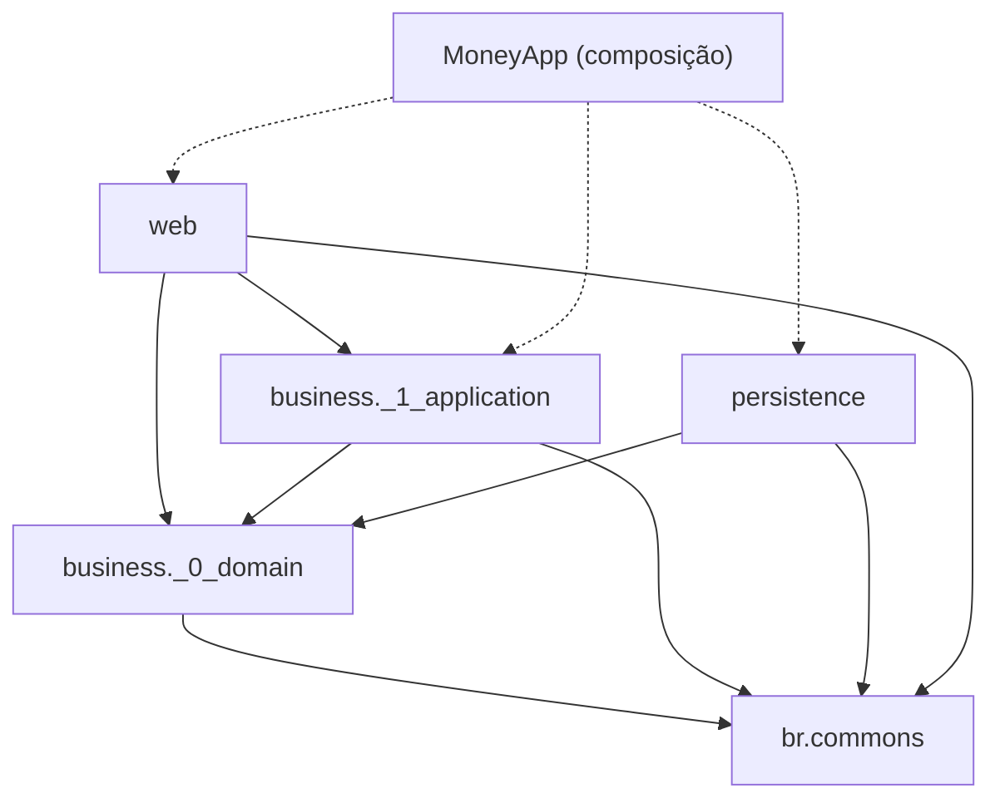
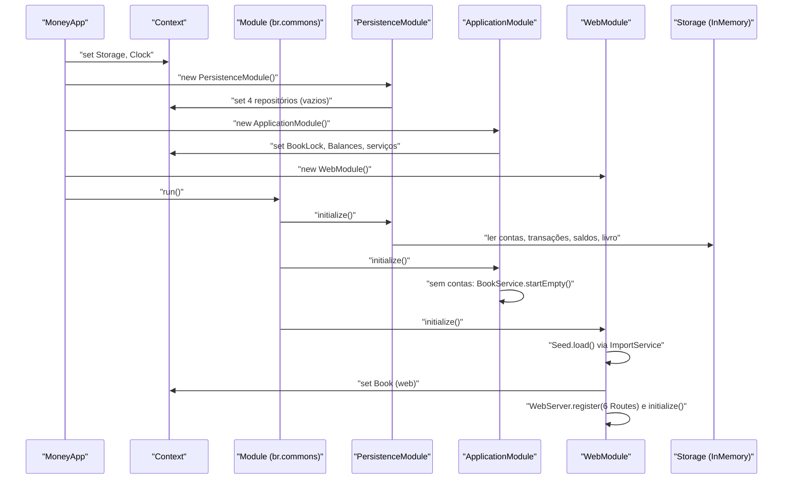
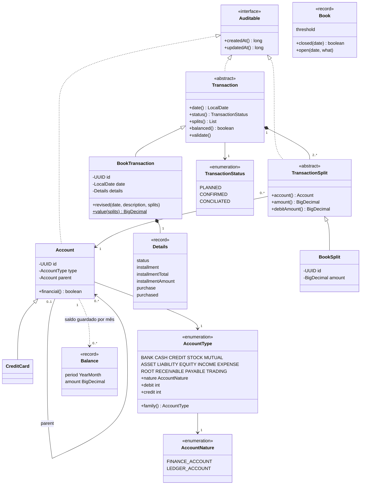
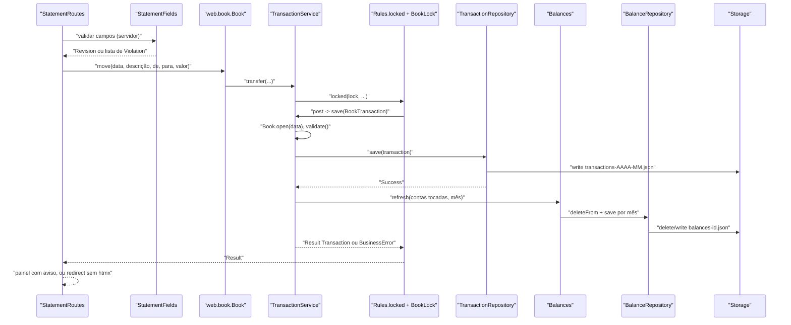
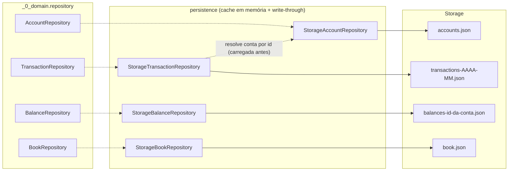
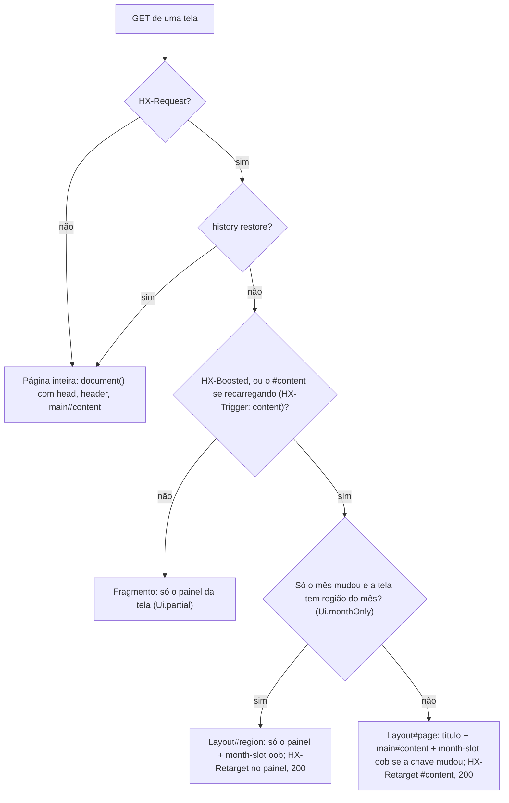
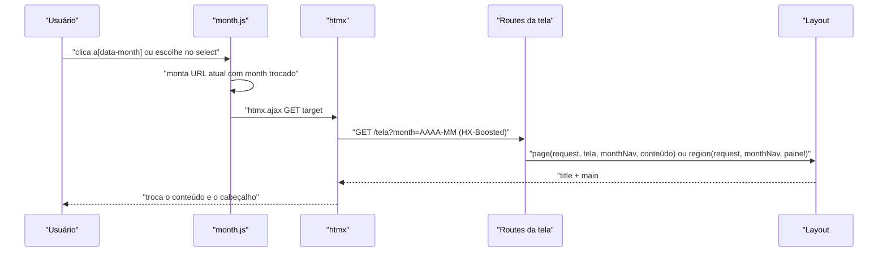
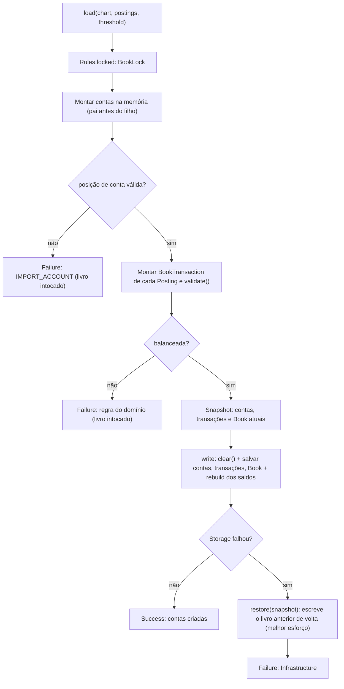

# br.money — Arquitetura

> Documento extraído do código em 2026-10-23 (pacote `br.bundled.money`). Onde o código e outro documento divergem,
> vale o código; as divergências estão na seção 13. O que não pôde ser confirmado no código está marcado como
> "não confirmado".

## 1. Visão geral e objetivo

`br.money` é uma aplicação web de contabilidade pessoal por partidas dobradas, escrita sem framework de mercado sobre
`br.commons` (módulos, `Context`, `Result`, `Storage`, DSL `Html5`/`Htmx`, `WebServer`). Este documento descreve a
**estrutura**: camadas, responsabilidades, fluxos e decisões. Ele não repete regras de negócio nem de tela.

| Documento | Conteúdo | Quando consultar |
|---|---|---|
| [INTENT.md](INTENT.md) | Produto: escopo (F1–F10), regras contábeis (§6), UX (§7) | Para saber o que o produto deve fazer |
| [AGENTS.md](AGENTS.md) | Guia de convenções e regra de dependência | Antes de criar ou mover código |
| [BUSINESS.md](BUSINESS.md) | Regras de negócio como o código as implementa | Para saber o que cada regra faz |
| [UI.md](UI.md) | Telas, componentes e comportamento do front-end | Para saber como cada tela se comporta |
| [BACKLOG.md](BACKLOG.md) | Pendências (hoje só o cabeçalho, sem itens) | Para ver o que está em andamento |

## 2. Camadas e regra de dependência

Cada camada importa apenas as de número menor, `br.commons` e o JDK. Conferido nos `import`s: `_0_domain` não importa
`_1_application`, `persistence` nem `web`; `persistence` importa só `_0_domain` e `br.commons`; `web` não importa
`persistence` (só `MoneyApp` conhece as três).

| Camada | Pacote | Pode depender de | Nunca de |
|---|---|---|---|
| Domínio | `business._0_domain` | `br.commons`, JDK | aplicação, persistência, web |
| Aplicação | `business._1_application` | domínio, `br.commons` | persistência, web |
| Persistência | `persistence` | domínio, `br.commons.persistence`, `br.commons.lang` | aplicação, web |
| Web | `web` | aplicação, domínio (tipos), `br.commons.web`, `br.commons.lang` | persistência |
| Composição | `MoneyApp` | todas | — |

As setas de ligação em tempo de execução não são imports: os módulos registram implementações no `Context`
(seção 4), e quem precisa de um contrato o pede por `Context.get(Interface.class)`.

Diagrama: dependências permitidas (seta = "depende de"); a linha tracejada é composição em tempo de execução.

Não há teste ArchUnit para `br.bundled.money` (os testes de arquitetura existentes estão em `br.commons`); a regra é
convenção e revisão.

## 3. Mapa de pacotes

| Pacote / classe | Papel |
|---|---|
| `MoneyApp` | Estende `br.Application`; registra `Storage` e `Clock` no `Context` e anexa os três módulos |
| `business._0_domain.model` | `Account`, `CreditCard`, `AccountType`, `AccountNature`, `Transaction`, `BookTransaction`, `TransactionSplit`, `BookSplit`, `TransactionStatus`, `Balance`, `Book` (registro com a data-limite), `Statement`, `Auditable`, `ChartTemplate` |
| `business._0_domain.repository` | Contratos: `AccountRepository`, `TransactionRepository`, `BalanceRepository`, `BookRepository` |
| `business._0_domain.service` | Contrato `BalanceService` (implementado por `Balances`, na aplicação) |
| `business._0_domain.DomainErrors` | Chaves de erro (`money.*`) e fábricas `rule`/`notFound`/`validation`; registra o bundle no `I18N` |
| `business._1_application` | `ApplicationModule`, `TransactionService`, `AccountService`, `BookService`, `ImportService`, `Balances`, `BookLock`, `Rules` (pacote), `AccountInput`, `SplitInput` |
| `persistence` | `PersistenceModule`, `StorageAccountRepository`, `StorageTransactionRepository`, `StorageBalanceRepository`, `StorageBookRepository`, `Records` |
| `web` | `WebModule` (servidor HTTP na porta 9000) |
| `web.book` | `Book` (fachada de leitura e escrita das telas), `LedgerLine`, `Installment` |
| `web.ui` | `Layout`, `Screen`, `Theme` (package-private), `Ui`, `Forms`, `Ledger` |
| `web.home`, `web.statement`, `web.installment`, `web.entry`, `web.account`, `web.report` | Uma pasta por tela: `*Routes` (público) e `*Views` (package-private); `*Fields` onde há formulário; `QuickEntry` em `entry` |
| `web.seed` | `Seed` (livro de desenvolvimento) e `GnuCashSeed` (leitor de XML do GnuCash) |
| `web/static` | `app.css` e oito scripts (seção 9), servidos em `/static/money/` |
| `src/main/resources/br/bundled/money` | `messages_pt_BR.properties`, `messages_en_US.properties`, `plano-pessoal.txt` |

## 4. Composição e ciclo de vida

`MoneyApp` (`public MoneyApp()`) faz, nesta ordem:

1. `Context.set(Storage.class, InMemoryStorage::new)` e `Context.set(Clock.class, ...)` com `America/Sao_Paulo`.
2. `attach(new PersistenceModule())`, `attach(new ApplicationModule())`, `attach(new WebModule())`.

`Application#attach(Lifecycle)` envolve cada ciclo em um `Module`; `Module#initialize` inicializa as dependências **na
ordem em que foram anexadas** e para na primeira falha; `terminate` desfaz só o que foi inicializado, em ordem
inversa. Logo: Persistência, depois Aplicação, depois Web.

Há dois momentos distintos, e a diferença importa:

- **Construção** (no `new XModule()`): `Context.set(Tipo.class, Supplier)` executa o supplier **na hora** (`Context` é
  eager; só a publicação é sob lock). Por isso `PersistenceModule` cria os quatro repositórios e `ApplicationModule`
  cria `BookLock`, `Balances`, `TransactionService`, `AccountService`, `ImportService`, `BookService`, cada um depois
  dos que ele pede (`ApplicationModule` registra também `BalanceService` apontando para `Balances`). Nesse momento os
  repositórios existem, mas ainda estão vazios.
- **`initialize`**: só aqui os dados são carregados e o livro é preparado.

| Passo | Módulo | O que faz |
|---|---|---|
| 1 | `PersistenceModule#initialize` | `load()` de contas, depois transações, saldos e livro; erro vira `BusinessError.Infrastructure` e impede a partida |
| 2 | `ApplicationModule#initialize` | Se `AccountRepository#findAll` está vazio, `BookService#startEmpty` (plano pessoal, F8) |
| 3 | `WebModule#initialize` | `Seed.load()`, registra `Book` (web) no `Context`, monta `WebServer` na porta 9000 com `RequestLoggingFilter`, `HtmxScript` e `StaticFiles`, registra as seis `*Routes` |

`WebModule` serve os estáticos do disco (`src/main/java/br/bundled/money/web/static`) quando a pasta existe
(desenvolvimento, sem rebuild do CSS) e do classpath caso contrário.

`Seed.load()`: se a propriedade `br.commons.money.seed.gnucash` aponta um arquivo, carrega o livro GnuCash (substitui o
que houver); senão, só carrega o livro fictício se não houver nenhuma transação. Ambos passam por
`ImportService#load` (seção 10).

Diagrama: sequência da partida (`MoneyApp#main` até o servidor ouvindo).

## 5. Modelo de domínio

Pontos de estrutura (as regras estão em [BUSINESS.md](BUSINESS.md)):

- **Natureza derivada do tipo**: `Account#financial()` é `type.nature == AccountNature.FINANCE_ACCOUNT`; não há campo
  próprio. `AccountType` guarda `debit` e `credit` (+1/−1) e converte valores (`debited`, `credited`, `family`).
- **`Account` é mutável e viva**: as divisões (`BookSplit`) apontam para a instância; `parent` é uma referência de
  objeto (null só no topo). `CreditCard` é uma `Account` com tipo `CREDIT` (usada só em `TransactionTest`; o código principal
  identifica cartão pelo tipo).
- **`BookTransaction` e `BookSplit` são imutáveis**; `BookTransaction#revised` devolve cópia com a mesma identidade.
  `Transaction#validate` exige ao menos duas divisões e balanceamento (`DomainErrors.TRANSACTION_SPLITS`,
  `TRANSACTION_UNBALANCED`).
- **`Book` (domínio)** é um `record Book(LocalDate threshold)`: só guarda a data-limite; `Book#open` lança
  `BusinessException` com `DomainErrors.PERIOD_CLOSED`.
- **`Balance`** é `record(YearMonth period, BigDecimal amount)`, um item do cache de saldos.
- `Statement` é uma interface do domínio (conta + mês + transações) sem implementação nem uso encontrados.

Diagrama: classes do domínio e seus relacionamentos.

## 6. Camada de aplicação

### 6.1 Serviços

| Classe | Responsabilidade | Métodos principais |
|---|---|---|
| `TransactionService` | Lançar, revisar e descartar transações; recalcular saldos | `post`, `transfer`, `revise`, `discard`, `moving` (estático), leituras `find`, `all`, `month`, `statement` |
| `AccountService` | Plano de contas: criar (com saldo de abertura), atualizar, remover movendo lançamentos | `create`, `update`, `remove`, `accounts`, `account`, `children`, `uses` |
| `BookService` | Livro como um todo: data-limite e recomeço | `book`, `close`, `startEmpty` |
| `ImportService` | Carga de um livro inteiro, com restauração | `load` (+ records `Line`, `Posting`) |
| `Balances` | Implementa `BalanceService`; lê o cache e o recalcula | `balance`, `own`, `subtree`, `refresh`, `rebuild` |
| `BookLock` | `extends ReentrantLock`; chave própria no `Context` | — |
| `Rules` (classe package-private) | Helpers comuns: `locked`, `stored`, `revised` | — |
| `AccountInput`, `SplitInput` | Entradas imutáveis dos casos de uso | — |

### 6.2 Lock único e tratamento de erro

- Todo caso de uso que escreve roda em `Rules.locked(lock, trabalho)`, que usa `Threads.locked` sobre o `BookLock`
  compartilhado: o livro muda **um caso de uso por vez**. O lock é reentrante porque um caso de uso chama outro
  (por exemplo `TransactionService#transfer` chama `post`).
- Dentro do lock, uma `BusinessException` do domínio vira `Result.failure(e.getError())` (`Rules.locked`).
- Uma falha do `Storage` (os repositórios devolvem `Result<T, String>`) vira
  `BusinessError.Infrastructure` por `Rules.stored`.
- Resultado: todo caso de uso responde `Result<T, BusinessError>`; a aplicação **não renderiza texto**, quem renderiza
  é a borda (`error.render()` na web, seção 11).
- Leituras (`find`, `all`, `month`, `statement`) não usam o lock.

### 6.3 Saldos guardados

`BalanceRepository` guarda, por conta, o saldo no fim de cada mês em que a conta se moveu (apenas das próprias
divisões, na natureza da conta). `Balances#refresh(contas, mês)` apaga os saldos daquele mês em diante e os refaz a
partir do saldo do mês anterior mais o que se moveu em cada mês com movimento. Quem altera transações chama `refresh`:
`TransactionService#save`/`discard`, `AccountService` (abertura e remoção) e `Balances#rebuild` (depois de uma carga).
`Balances#balance` para conta contábil soma a subárvore convertendo a natureza; conta financeira mostra só o próprio
saldo. A fachada web `Book` completa o dia corrente somando as transações do mês ao saldo guardado do mês anterior
(`Book#own`).

Diagrama: sequência de "lançar uma transação" pelo extrato (formulário simples, `POST /statement/transactions`).

Ordem exata em `TransactionService#save`: descrição não vazia, `books.find().open(data)`, `validate()`, gravar a
transação e só então `balances.refresh`. A revisão considera o menor entre o mês novo e o mês antigo. Nada é revertido
se `refresh` falhar depois de a transação ter sido gravada (não confirmado nenhum desfazer nesse caminho); o desfazer
existe apenas em `AccountService#create` (abertura que falha) e em `ImportService#load`.

## 7. Persistência

`persistence` implementa os quatro contratos de repositório sobre `br.commons.persistence.Storage`, uma API de
`arquivo` + `chave JSON` -> `byte[]`: `read`, `write`, `delete`, `keys`, `exists`, `listFiles(prefixo, sufixo)`, todos
devolvendo `Result<_, String>`. `MoneyApp` registra `InMemoryStorage` (dados só na memória). O `package-info` de
`persistence` afirma que `LocalFileStorage` (existente em `br.commons.persistence.json`) o substitui sem mudar código;
isso não é usado por `MoneyApp` hoje.

- **Formato**: cada registro é um `record` serializado com `Json` por `Records#write`/`Records#read`. Um campo ilegível
  vira `DomainErrors.STORAGE_UNREADABLE` (`Records#unreadable`) e interrompe a partida.
- **Cache write-through**: cada repositório mantém em memória o que carregou; leituras nunca tocam o `Storage`;
  escritas gravam primeiro e só atualizam o cache se a gravação der certo. Métodos `synchronized` (exceto
  `StorageBookRepository#find`, que lê um campo `volatile`).
- **Ordem de carga** (`PersistenceModule#initialize`): contas (liga cada filha à mãe; mãe ausente falha), transações
  (resolve cada divisão pela conta; conta ausente falha), saldos, livro.
- **Contas são instâncias vivas**: `AccountRepository#findAll`/`findById` devolvem os objetos guardados; para alterar,
  muda-se a instância e chama-se `save`.

| Arquivo (`Storage`) | Chave | Registro |
|---|---|---|
| `accounts.json` | id da conta | `AccountRow(id, name, description, type, parent, createdAt, updatedAt)` |
| `transactions-AAAA-MM.json` | id da transação | `TransactionRow` com `splits` (`SplitRow`); o arquivo é o do mês da data |
| `balances-<id da conta>.json` | `AAAA-MM` | `BalanceRow(amount)` |
| `book.json` | `book` | `BookRow(threshold)` |

`StorageTransactionRepository#save` grava no arquivo do mês novo e, se a data mudou de mês, remove a chave do arquivo do
mês antigo. Quando o último campo de um arquivo é removido, o `InMemoryStorage` descarta o arquivo.

Diagrama: repositórios, cache e arquivos do `Storage`.

## 8. Camada web

### 8.1 Peças

- **Rotas**: cada `*Routes` implementa `br.commons.web.server.WebResource` e registra, em `routes(Router)`, chamadas como
  `router.register(Route.get(caminho, MediaType.TEXT_HTML, String.class, true, this::handler)).getOrThrow()`. `WebModule` registra as seis:
  `HomeRoutes`, `AccountRoutes`, `StatementRoutes`, `InstallmentRoutes`, `EntryRoutes`, `ReportRoutes`. Rotas literais
  vêm antes das com `{id}` (a primeira que casa vence).
- **Par `*Routes`/`*Views`**: `*Routes` lê a requisição, chama `Book`, e escolhe a resposta; `*Views` (`final class`
  package-private) só monta `Node` com `Html5`/`Htmx` e recebe dados prontos.
- **`web.book.Book`**: fachada registrada em `Context` por `WebModule`. Lê dos serviços e converte para o que a tela
  precisa (árvore, caminho `A › B`, saldo do dia, razão com saldo corrente via `LedgerLine`, parcelas via
  `Installment`, contas/cartões/categorias que a tela oferece); escritas repassam ao serviço e devolvem o `Result`.
  Contém só cálculo de tela.
- **`web.ui`**: `Layout` (a página em volta), `Screen` (enum do menu: caminho, rótulo, ícone), `Ui` (formatação
  pt-BR de dinheiro, mês e dia; `partial`, `boosted`, `reload`, `monthOnly`, `shown`, `ok`, `pathId`, `uuid`,
  `monthOf`, `errorOf`), `Forms`
  (mensagens de violação, escolha de conta, campo rotulado), `Ledger` (resumo, colunas e `monthNav`), `Theme`
  (botões do tema). O `Layout` também tem o contêiner `#entry-modal` do lançamento rápido, aberto pelo menu.
- **Telas**: ver o mapeamento tela → rota em [UI.md](UI.md); aqui só a estrutura.

| Feature | Rotas (resumo) | Observação de estrutura |
|---|---|---|
| `home` | `GET /` | Fragmento do gráfico por contas marcadas (`/` parcial), com as caixas na URL |
| `statement` | `/statement`, `/statement/transactions...` | Editor simples e de divisões (`SplitFields`) |
| `installment` | `GET /installments` | Parcelas calculadas por `Book#installments` |
| `entry` | `GET /entries/new` (janela ou página), `GET /entries/editor`, `POST /entries` | Lançamento rápido numa janela sobre a tela atual (`QuickEntry`, `EntryFields`); salvar recarrega o conteúdo da tela por trás (evento `book-changed`) |
| `account` | `/accounts...` | `RegisterViews` + `AccountFields`; recomeço por `/accounts/empty` |
| `report` | `/reports`, `/reports/balance`, `/income`, `/evolution`, `/closing` | `closing` altera a data-limite |

### 8.2 Uma URL, só o que muda

A mesma URL responde a página inteira, só o conteúdo (navegação *boosted*, ou o `#content` se recarregando depois de
um lançamento rápido), só a parte que o mês muda ou só um fragmento, conforme os cabeçalhos da requisição
(`Ui.partial`, `Ui.boosted`, `Ui.reload`, `Ui.monthOnly`, sobre `HtmxRequest.fragment`/`navigation`). `Ui.html` acrescenta
`Vary: HX-Request, HX-Boosted, HX-History-Restore-Request, HX-Trigger, HX-Current-URL, Month-Key` para que um cache não troque uma resposta pela
outra. A resposta *boosted* sempre sai com status 200 (htmx descarta resposta de erro sem trocar o conteúdo), mesmo que
a página inteira use outro status. O menu nunca volta do servidor: a página inteira marca o link da tela (`aria-current`) e, depois de uma navegação,
`header.js` marca o do `data-screen` do `<main>`.

Diagrama: decisão de resposta numa rota de tela (`Layout#page`, `Layout#region` e `Ui#partial`).

As telas `report` e `HomeRoutes#home` seguem o mesmo padrão; `/reports` responde sempre por
`Layout.page`.

### 8.3 Navegação de mês no cabeçalho

`Ledger#monthNav` monta a navegação (anterior, seletor, próximo, "Hoje") e `Layout` a coloca em `#month-slot`, ao lado do
menu. Em navegação *boosted*, o `month-slot` vai junto como `hx-swap-oob` (vazio em tela sem mês) só quando muda: ele
guarda em `data-key` a chave do que mostra (`MonthNav#key`: mês, mês atual e primeiro mês; a navegação só é
montada quando vai), `month.js` manda essa chave em todo pedido htmx (cabeçalho `Month-Key`) e o
`Layout` compara. `month.js` intercepta o clique (fase de captura) e chama `htmx.ajax('GET', url, {target:
'#content', swap: 'outerHTML'})` com a URL atual e `month=` trocado, mantendo os demais parâmetros. Se só o mês mudou
(`Ui.monthOnly`), Plano de contas e Parcelamentos respondem só o painel (`Layout#region`, sem rolar a janela); Extrato
e relatórios, o conteúdo.

Diagrama: sequência de uma troca de mês.

### 8.4 Formulários

- **Campos declarados uma vez**: cada `*Fields` declara `Field` com `FieldSpec.of(nome, InputType...)` (obrigatório,
  mínimo, passo, tamanho). A view renderiza com o `DIALECT` (tipos e restrições HTML5) e `*Fields#read` valida no
  servidor com `Validation.check`, mais o que um campo sozinho não expressa (conta financeira, categoria de
  receita/despesa, data fora do período fechado por `Forms.open`).
- **Retorno de `read`**: `Result<Entrada, List<Violation>>`. A rota faz `switch` sobre o `Result`; em sucesso chama
  `Book`, em falha re-renderiza o formulário com `Ui.errorOf` ao lado do campo (texto por `Forms.violation`).
- **Erro de regra** (vindo do serviço) é mostrado com `error.render()`: aviso no painel (extrato), mensagem no formulário
  (lançamento rápido) ou nota na árvore (plano de contas, inclusive o fechamento).
- **Com htmx**, formulário inválido sai com `HX-Retarget` e `reswap` `outerHTML` no próprio formulário
  (`StatementRoutes#invalid`, alvo `#transaction-form`); sucesso devolve o painel com aviso e a lista de contas
  *out of band*.
- **Sem htmx**: sucesso faz post/redirect/get (`WebResponse.redirect`) para o extrato, o início ou o plano de contas; falha de
  regra no extrato volta a página inteira com status 422 (`after`). Formulário inválido sem htmx: `EntryRoutes` re-renderiza
  a tela inteira; `StatementRoutes#invalid` não distingue htmx (usa sempre o retarget).
- `PUT`/`DELETE` são enviados por htmx; `/accounts/{id}` aceita `POST` também, para formulário sem htmx.

## 9. Front-end estático

Servido em `/static/money/` (`StaticFiles("/static/money/", ...)`). Todo script é carregado no
`<head>` de `Layout#document`, uma vez; age por delegação no `document` e em eventos htmx (`htmx:load`), então vale para
conteúdo trocado. Detalhes de comportamento em [UI.md](UI.md).

| Arquivo | Função | Carga no `<head>` |
|---|---|---|
| `app.css` | Estilo, tema por `data-theme` | `<link rel="stylesheet">` |
| `theme.js` | Tema auto/claro/escuro (localStorage + `data-theme`) | síncrono, antes da pintura |
| `combo.js` | Filtro ao vivo em todo `<select>` | `defer` |
| `chart.js` | Gráfico de linhas Receitas x Despesas desenhado a partir de uma tabela | `defer` |
| `header.js` | Altura real do cabeçalho em `--top-height`; tela atual no menu (`aria-current`) | `defer` |
| `month.js` | Navegação de mês (seção 8.3) | `defer` |
| `tree.js` | Ramos recolhíveis do plano de contas (localStorage) | `defer` |
| `outline.js` | Linhas recolhíveis em qualquer nível (`table.outline`) | `defer` |
| `splits.js` | Totais do formulário de divisões enquanto se digita | `defer` |
| `money.js` | Valor em reais formatado ao digitar (2 casas, `1.234,56`) | `defer` |
| `history.js` | Caixas marcadas guardadas como estão no histórico do htmx | `defer` |

O script do htmx vem de `htmxScript()` (`HtmxScript` registrado no servidor). O tema só existe no navegador: o servidor
apenas renderiza os botões (`Layout#themeSwitch`, escondidos até o `theme.js` revelá-los).

## 10. Carga do livro

`ImportService#load(chart, postings, threshold)` substitui o livro inteiro. É usado por `BookService#startEmpty`
(plano pessoal de `ChartTemplate#personal`, lido de `plano-pessoal.txt`) e por `Seed` (livro fictício ou
`GnuCashSeed#book`). Na carga as regras de tela não valem (topo fixo, período fechado), mas toda transação precisa
balancear (`Transaction#validate`). `GnuCashSeed` lê o XML (gzip ou não) com StAX, converte tipos legados, define o tipo
financeiro das folhas pelo nome do grupo, fixa cada transação em centavos e transforma o limiar de leitura do GnuCash em
data-limite.

Diagrama: fluxo de carga com "montar e conferir antes de remover; restaurar em falha".

`GnuCashSeed` e os erros `IMPORT_UNREADABLE`, `IMPORT_MALFORMED`, `IMPORT_ACCOUNT_TYPE` falham **antes** de
`ImportService#load` (a leitura do arquivo termina antes de qualquer remoção).

## 11. Erros e i18n

- **Domínio**: `DomainErrors` define as chaves (`money.*`) e as fábricas `rule` (`BusinessRule`), `notFound`
  (`NotFound`), `validation` (`Validation`). O bloco `static { I18N.register(PREFIX, BUNDLE); }` registra o bundle
  `br/bundled/money/messages`; as chaves são constantes inlinadas, por isso os erros são criados pelas fábricas, que
  garantem o carregamento da classe.
- **Textos**: `messages_pt_BR.properties` e `messages_en_US.properties` (21 linhas cada, no momento da leitura).
- **Tipos de erro** (`br.commons.business.BusinessError`, selada): `NotFound`, `BusinessRule`, `Validation`, `Conflict`,
  `Infrastructure(message)`. Só `render()`/`render(Locale)` vira texto; `Infrastructure` já traz o texto pronto (os
  repositórios o geram com `DomainErrors.rule(...).render()` em `Records#unreadable`).
- **Onde o texto aparece**: nas rotas, com `error.render()` (por exemplo `StatementRoutes#outcome`). Textos fixos de UI
  são chaves `forms.*` resolvidas por `Ui.message`; dados do usuário entram por `Text.data(...)` (o tipo `Text` separa texto de
  interface de dado).
- **Textos de interface e mensagens de validação** (`Forms.violation`, `Forms.CLOSED`, `*Fields#message`) são chaves
  `forms.*` do bundle `forms` (pt_BR, en_US), resolvidas por `Ui.message`/`Ui.string` (`I18N.of`, prefixo registrado em
  `Ui`); `FormsBundleTest` confere que os dois idiomas têm as mesmas chaves e que toda chave citada existe.

## 12. Testes

Comando: `mvn test` (README do repositório: compila com Error Prone e NullAway e roda os testes; `mvn verify` adiciona
PMD, CPD e JaCoCo). O `pom.xml` passa `--add-modules jdk.incubator.vector` à JVM de teste. Filtrar só este módulo, com
o padrão `-Dtest` do Surefire, é uma sugestão não executada aqui. Não há `Makefile`.

| Classe | Cobre |
|---|---|
| `business/_0_domain/model/TransactionTest` | Balanceamento (cartão, transferência, pagamento de fatura), divisão única recusada, mensagens do bundle, `debitAmount`, `purchase` nulo |
| `business/_1_application/ApplicationModuleTest` | Partida e plano pessoal; saldo de abertura e patrimônio de abertura; hierarquia; remoção de conta com destino; transação com várias divisões; regras de transação; revisão entre meses; identidade das divisões; período fechado; reinício sobre o mesmo `Storage`; recomeço; carga inválida deixa o livro como estava |
| `persistence/PersistenceModuleTest` | Ida e volta dos quatro arquivos; mudança de mês remove do arquivo antigo; divisão com conta desconhecida falha a carga |
| `web/book/InstallmentTest` | Detecção de parcela na descrição (`k/N`, o último vale, "PARCELA k DE N"), parcela da transação e `remaining` |
| `web/seed/GnuCashSeedTest` | Tipos legados, contas sem equivalente (omitidas ou falha) e arquivo ilegível |

Sem testes para: rotas e views, `Layout`, `Forms`, `Book` (exceto `Installment`), `Balances` isolado, `TransactionService`
sem `ApplicationModule`, `Seed` fictício e o front-end (não confirmado nenhum teste de JavaScript).

## 13. Decisões, trade-offs e divergências

### 13.1 Decisões observadas

| Decisão | Motivo visível no código | Custo |
|---|---|---|
| Dois `Book`: `web.book.Book` (fachada de tela) e `_0_domain.model.Book` (data-limite) | Cada um serve a sua camada | Mesmo nome simples; confusão em imports |
| Contas como instâncias vivas | Divisões apontam para a `Account`; mudança no lugar + `save` | Estado mutável compartilhado; exige o lock único |
| Saldos guardados por mês, recalculados por `refresh` | Saldo sem varrer todas as transações | Quem altera transações deve chamar `refresh`; a web ainda soma o mês corrente em `Book#own` |
| Um `BookLock` global | Simplicidade para usuário único | Sem concorrência de escrita |
| Cache write-through nos repositórios | Leitura nunca falha nem toca o `Storage` | Todo o livro fica em memória |
| `Result<T, BusinessError>` na aplicação, `Result<T, String>` nos repositórios | Falha esperada como valor | Conversão em `Rules.stored` |
| `*Views` package-private, `*Routes` públicas | A view não é chamada de fora da feature | Teste de view precisa estar no mesmo pacote |
| Todo JS no `<head>`, por delegação | Navegação *boosted* troca só `#content`; scripts carregam uma vez | Scripts precisam se reaplicar a cada `htmx:load` |
| Mesma URL, só o que muda volta | Funciona com e sem htmx (melhoria progressiva); respostas pequenas | Rotas precisam de `Ui.partial`/`Layout.page` em todo caso |
| Ordem dos módulos = ordem de `attach` | `Module#initialize` percorre dependências em sequência | A ordem em `MoneyApp` é parte do contrato |
| `Seed` dentro de `web` e chamada em `WebModule#initialize` | Dado de desenvolvimento fora do domínio | `web.seed` depende de `ImportService` (aplicação) |

### 13.2 Divergências código x documentos

- **INTENT §2/§8 diz PostgreSQL via `br.commons.persistence.jdbc`**; o código usa `Storage` JSON com
  `InMemoryStorage` (dados se perdem ao reiniciar; o rodapé do `Layout` mostra "Dados em memória"). `LocalFileStorage`
  existe em `br.commons`, mas `MoneyApp` não o liga.
- **INTENT F5/F6 (importação de PDF)** e **F7 (exportação GnuCash e round-trip)**: não existem no código lido. Há apenas
  leitura de GnuCash XML como *seed* de desenvolvimento (`GnuCashSeed`, StAX em `web/seed`), e **não** um `Xml` em
  `br.commons.lang` como o INTENT §2 prescreve (não confirmado nenhum `Xml` ali).
- **INTENT §6 (vínculo de parcela em slots do GnuCash `br-money/...`)**: o vínculo é o campo `purchase` do
  `TransactionRow`; a menção a slots só aparece em comentário de `Transaction#purchase`. Sem exportação não há slot.
  Parcelas sem esse campo são reconhecidas pela descrição em `Installment.of` (regex), uma heurística da web.
- **INTENT §10 (Livro como entidade)**: o código tem `Book` como `record` só com a data-limite; o GUID da conta raiz
  não existe.
- **AGENTS.md** foi alinhado ao código em 2026-10-23 (`MoneyApp`, serviços que pegam repositórios do `Context`, scripts
  estáticos, formulário inválido e post/redirect/get, mensagens de campo em texto pt-BR); não há divergência conhecida
  entre ele e o código além do que está nos itens abaixo.
- **AGENTS §4: "`*Views` não acessa repositório nem regra"**: confirmado (nenhum import de repositório na web).
- **`web/package-info.java`**: ordem de dependência `book`, `seed`, `ui`, features; `ui` importa `web.book.Book`
  (confirmado em `Forms` e `Ledger`).
- **`persistence/package-info.java` e AGENTS** citam `LocalFileStorage` como substituto sem mudança de código: o
  contrato permite, mas a troca real não foi exercitada nem testada aqui (não confirmado).
- **`CreditCard` e `Statement`** existem no domínio sem uso no código principal (`CreditCard` só em `TransactionTest`;
  `Book#card` identifica cartão pelo tipo `CREDIT`, não pela classe).
- **`BACKLOG.md`** não tem itens (apenas cabeçalho), apesar de AGENTS e INTENT o referenciarem.

### 13.3 Dívidas visíveis

- Persistência só em memória: sem durabilidade.
- Sem desfazer de uma transação já gravada quando `Balances#refresh` falha (seção 6).
- Sem teste automático de rotas, views, front-end nem de arquitetura em `br.bundled.money`.
- Sem exportação e sem importação de extrato PDF (INTENT F5, F6, F7).
